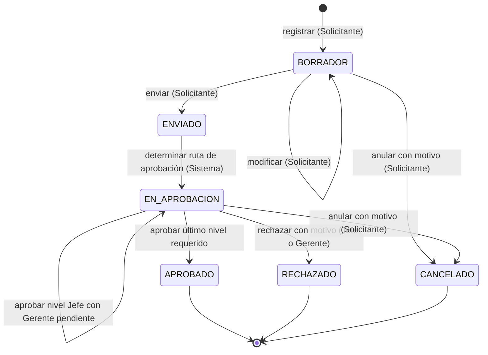

# Feature Specification: Registro y aprobación de pedidos

**Feature Branch**: `001-registro-aprobacion-pedidos`

**Created**: 2026-11-16

**Status**: Draft

**Input**: User description: "Especifica la feature usando como entrada @docs/prompts/features/001-registro-aprobacion-pedidos/01-specify.md"

## Clarifications

### Session 2026-11-17

Fuente de decisiones: `docs/prompts/features/001-registro-aprobacion-pedidos/02-clarify.md`.

- Q: ¿Un pedido de exactamente S/ 5 000.00 lo aprueba solo el Jefe o también el Gerente? → A: Solo el Jefe (D1). Hasta S/ 5 000.00 inclusive aprueba solo el Jefe; desde S/ 5 000.01, Jefe y luego Gerente. Reemplaza la respuesta del 2026-11-16 (≥ S/ 5 000.00).
- Q: Con el modelo de organigrama, ¿quién aprueba el nivel Jefe si el jefe directo del Solicitante no tiene rol de Jefe? → A: El nivel Jefe se asigna a la primera persona con rol Jefe en la línea jerárquica ascendente del Solicitante, y el nivel Gerente a la primera con rol Gerente por encima de ese Jefe; si falta alguno, el pedido no puede enviarse (RN-11). Cada nivel solo lo aprueba su rol (D3).
- Q: Sin interfaz en esta feature (D25), ¿qué se hace con SC-002 (aprobador decide en menos de 1 minuto)? → A: La medición de 1 minuto se traslada a la feature de interfaz; aquí, el aprobador consulta su bandeja y decide sobre un pedido en 2 operaciones (mismo criterio que D26 para SC-001).
- Q: ¿"Mis pedidos" debe cumplir la misma meta de rapidez que la bandeja? → A: Sí; el 95 % de las consultas de bandeja y de "mis pedidos" responde en menos de 1 segundo con 10 000 pedidos registrados en todos los estados (D10, D18, D20).
- Q: ¿El Auditor es un rol propio o una facultad de un rol existente? → A: Rol propio AUDITOR, de solo consulta. Requiere una enmienda MENOR de la constitución (Principio VI), que queda como dependencia fuera de esta spec.

Decisiones del registro aplicadas sin pregunta (coinciden con la spec o la completan):

- D2: monto máximo por pedido de S/ 50 000.00 inclusive; se valida al registrar y al modificar (RN-13).
- D3, D4: aprobación estrictamente secuencial por rol; un rechazo en cualquier nivel es final (RN-07, RN-08).
- D5: el Solicitante puede anular su pedido aunque ya tenga la aprobación del Jefe, mientras siga pendiente. "PENDIENTE_APROBACION" equivale al estado EN_APROBACION de la constitución; "anulado" equivale a CANCELADO.
- D6: solo soles (PEN), sin conversión (RN-03).
- D7, D21: precios con más de 2 decimales significativos se rechazan, sin redondeo; los ceros finales no cuentan (10.500 = 10.50; 10.555 se rechaza) (RN-12).
- D8, D11, D17: motivos de rechazo y de anulación obligatorios, de 10 a 500 caracteres, sin contar espacios iniciales ni finales; solo espacios cuenta como vacío (RN-09).
- D9: un pedido tiene entre 1 y 50 líneas (RN-01).
- D12: comentario de aprobación opcional, hasta 500 caracteres; si se indica, queda en el historial (RN-09).
- D13: descripción de línea de 3 a 200 caracteres; cantidad entera de 1 a 9 999 (RN-12).
- D14, D23: bandeja ordenada por fecha de envío ascendente, con número, solicitante, fecha de envío, total y nivel; un usuario Jefe y Gerente tiene una sola bandeja con ambos niveles (FR-015).
- D15: el Solicitante ve el historial de sus propios pedidos; el Auditor, el de todos (FR-016, FR-020).
- D16: el historial se conserva indefinidamente, sin borrado ni depuración (RN-14).
- D19, D26: la medición de SC-001 con usuarios pasa a la feature de interfaz; aquí, registrar y enviar en 2 operaciones.
- D22: detalle con líneas visible para el Solicitante (sus pedidos), el Jefe o Gerente (los de su bandeja) y el Auditor (cualquiera) (FR-021).
- D24: "mis pedidos" ordenado por fecha de registro descendente, con filtro opcional por estado (FR-014).
- D25: la feature es solo el servicio; la interfaz de usuario es otra feature (Fuera de alcance).
- D27: bandeja y listas vacías se devuelven como lista vacía; el texto lo muestra el cliente.

Decisiones de la revisión de `checklists/flujo-aprobacion.md` (2026-11-17):

- Q: ¿Qué facultades tiene el Administrador en esta feature? → A: Ninguna; queda fuera de los roles de esta feature (CHK006, CHK021).
- Q: ¿Qué pasa si el aprobador asignado deja de estar disponible? → A: Limitación conocida: el pedido queda pendiente hasta resolverse fuera del sistema; la reasignación sigue fuera de alcance (CHK007).
- Q: ¿La descripción de la línea se mide sin espacios iniciales ni finales? → A: Sí, con la misma regla que motivos y comentarios (CHK014).
- Q: ¿Qué es una solicitud de registro repetida? → A: Un reintento con el mismo identificador de solicitud; dos registros con datos iguales e identificadores distintos son dos pedidos (CHK015).
- Q: ¿Qué guarda el historial de una modificación? → A: Las líneas y el monto total antes y después del cambio (CHK004).
- Q: ¿Con qué volumen se mide "mis pedidos"? → A: Con un Solicitante que tiene 500 de los 10 000 pedidos (CHK017).
- Q: ¿Puede el aprobador asignado ver el historial de los pedidos de su bandeja? → A: Sí, para que el Gerente vea la decisión y el comentario del Jefe.

## User Scenarios & Testing *(mandatory)*

### User Story 1 - Registrar y enviar un pedido (Priority: P1)

Un Solicitante registra un pedido de compra con entre 1 y 50 líneas (descripción, cantidad,
precio unitario en soles). El pedido queda en borrador; mientras siga así, el Solicitante puede
modificarlo. Cuando está listo, lo envía a aprobación y deja de poder modificarlo.

**Rol(es)**: Solicitante

**Why this priority**: Sin pedidos registrados no existe nada que aprobar; es la puerta de
entrada de todo el proceso.

**Independent Test**: Un Solicitante registra un pedido de dos líneas, modifica una línea,
lo envía y comprueba que el pedido está en aprobación, con su monto total y sin poder editarse.

**Acceptance Scenarios**:

1. **Dado** un Solicitante autenticado, **Cuando** registra un pedido con dos líneas válidas,
   **Entonces** el pedido queda en estado BORRADOR, con un número de pedido, el Solicitante como
   creador y un monto total igual a la suma de cantidad × precio unitario de sus líneas, en soles.
2. **Dado** un pedido en BORRADOR del Solicitante, **Cuando** agrega, modifica o elimina una
   línea dejando entre 1 y 50, **Entonces** el cambio se guarda y el monto total se recalcula.
3. **Dado** un pedido en BORRADOR válido, **Cuando** el Solicitante lo envía, **Entonces** el
   pedido pasa a EN_APROBACION con su ruta de aprobación determinada por el monto total y queda
   pendiente del nivel Jefe, asignado al primer Jefe de la línea jerárquica del Solicitante
   (RN-07).
4. **Dado** un pedido ya enviado, **Cuando** el Solicitante intenta modificarlo,
   **Entonces** el sistema lo impide e indica que solo se modifican pedidos en borrador.
5. **Dado** un pedido en BORRADOR con una sola línea, **Cuando** el Solicitante intenta
   eliminarla, **Entonces** el sistema lo impide porque un pedido requiere al menos una línea
   (RN-01).
6. **Dado** un pedido con 50 líneas, **Cuando** el Solicitante intenta agregar la línea 51,
   **Entonces** el sistema lo impide (RN-01).
7. **Dado** una línea con datos fuera de rango (cantidad 0 o 10 000, cantidad no entera,
   descripción de 2 o de 201 caracteres, precio 0 o negativo), **Cuando** el Solicitante intenta
   guardarla, **Entonces** el sistema la rechaza indicando el dato inválido (RN-12).
8. **Dado** un precio unitario de 10.555, **Cuando** el Solicitante intenta guardarlo,
   **Entonces** el sistema lo rechaza sin redondear; un precio de 10.500 se acepta como 10.50
   (RN-12).
9. **Dado** un pedido cuyo total sería S/ 50 000.00, **Cuando** el Solicitante lo registra o
   modifica, **Entonces** se acepta; si el total fuera S/ 50 000.01, el sistema lo rechaza
   (RN-13).
10. **Dado** un Solicitante sin ningún Jefe en su línea jerárquica ascendente, **Cuando**
    intenta enviar su pedido, **Entonces** el sistema lo impide, informa la causa y el pedido
    sigue en BORRADOR (RN-11).
11. **Dado** un Solicitante cuyo jefe directo es Gerente y no tiene ningún Jefe por encima en su
    línea, **Cuando** intenta enviar un pedido, **Entonces** el sistema lo impide, porque un
    Gerente no puede aprobar el nivel Jefe (RN-07, RN-11).

---

### User Story 2 - Aprobar o rechazar como Jefe (Priority: P2)

Un Jefe revisa en su bandeja los pedidos pendientes que le fueron asignados y aprueba o rechaza
cada uno. Si el monto no requiere Gerente, su aprobación es definitiva; si lo requiere, el
pedido pasa al Gerente. Un rechazo exige motivo y es definitivo.

**Rol(es)**: Jefe

**Why this priority**: Completa el flujo mínimo de valor (registrar → aprobar) para la mayoría
de pedidos, que solo necesitan un nivel.

**Independent Test**: Con un pedido enviado cuyo monto solo requiere Jefe, el Jefe lo ve en su
bandeja, lo aprueba y el pedido queda APROBADO; con otro pedido, lo rechaza con motivo y queda
RECHAZADO.

**Acceptance Scenarios**:

1. **Dado** un pedido EN_APROBACION de S/ 1 200.00 pendiente de Jefe, **Cuando** el Jefe
   asignado lo aprueba, con o sin comentario, **Entonces** el pedido pasa a APROBADO y el
   comentario, si lo hay, queda en el historial.
2. **Dado** un pedido EN_APROBACION de S/ 8 000.00 pendiente de Jefe,
   **Cuando** el Jefe lo aprueba, **Entonces** el pedido sigue EN_APROBACION, pendiente de
   Gerente, y desaparece de la bandeja del Jefe.
3. **Dado** un pedido pendiente de Jefe, **Cuando** el Jefe lo rechaza con un motivo de entre 10
   y 500 caracteres, **Entonces** el pedido pasa a RECHAZADO y el motivo queda registrado.
4. **Dado** un pedido pendiente de Jefe, **Cuando** el Jefe intenta rechazarlo sin motivo, con
   solo espacios, con 9 caracteres o con 501, **Entonces** el sistema lo impide (RN-09).
5. **Dado** un pedido creado por un usuario que también es Jefe, **Cuando** ese mismo usuario
   intenta aprobarlo, **Entonces** el sistema lo impide (nadie aprueba su propio pedido) y el
   pedido no aparece en su bandeja; el pedido se asigna al siguiente Jefe de su línea
   jerárquica (RN-07).
6. **Dado** un pedido pendiente de Jefe, **Cuando** un Jefe distinto del asignado intenta
   aprobarlo o rechazarlo, **Entonces** el sistema lo impide y el pedido no aparece en su
   bandeja.
7. **Dado** que el Jefe decide sobre un pedido mientras el Solicitante lo anula, **Cuando**
   ambas acciones llegan a la vez, **Entonces** solo una se registra y la otra es informada de
   que el pedido ya cambió.
8. **Dado** un Jefe con varios pedidos asignados, **Cuando** consulta su bandeja, **Entonces**
   los ve ordenados del más antiguo al más reciente por fecha de envío, con número, solicitante,
   fecha de envío, total y nivel; si no tiene ninguno, recibe una lista vacía.

---

### User Story 3 - Aprobación de segundo nivel por Gerente (Priority: P3)

Para pedidos de monto alto (más de S/ 5 000.00), tras la aprobación del Jefe, el Gerente
asignado revisa en su bandeja y aprueba o rechaza el pedido. El Gerente nunca actúa antes que
el Jefe ni en su lugar.

**Rol(es)**: Gerente

**Why this priority**: Controla los pedidos de mayor riesgo económico; se apoya en las
historias 1 y 2.

**Independent Test**: Un pedido de monto alto aprobado por el Jefe aparece en la bandeja del
Gerente; al aprobarlo queda APROBADO; un pedido de monto alto aún pendiente de Jefe no aparece
en la bandeja del Gerente.

**Acceptance Scenarios**:

1. **Dado** un pedido de monto alto aprobado por el Jefe, **Cuando** el Gerente lo aprueba,
   **Entonces** el pedido pasa a APROBADO.
2. **Dado** un pedido de monto alto aprobado por el Jefe, **Cuando** el Gerente lo rechaza con
   motivo válido, **Entonces** el pedido pasa a RECHAZADO y el motivo queda registrado.
3. **Dado** un pedido de monto alto aún pendiente de Jefe, **Cuando** el Gerente intenta
   aprobarlo, **Entonces** el sistema lo impide porque falta la aprobación previa del Jefe.
4. **Dado** un pedido creado por un usuario que es Gerente, **Cuando** ese usuario intenta
   aprobarlo en el segundo nivel, **Entonces** el sistema lo impide.
5. **Dado** un pedido cuyo monto total es S/ 5 000.01, **Cuando** el Jefe lo aprueba,
   **Entonces** el pedido sigue EN_APROBACION, pendiente de Gerente (RN-05).
6. **Dado** un pedido cuyo monto total es exactamente S/ 5 000.00, **Cuando** el Jefe lo
   aprueba, **Entonces** el pedido pasa a APROBADO sin intervención del Gerente (RN-05).
7. **Dado** un pedido de monto alto aprobado por el Jefe, **Cuando** un Gerente distinto del
   asignado intenta aprobarlo, **Entonces** el sistema lo impide y el pedido no aparece en su
   bandeja.
8. **Dado** un usuario con roles Jefe y Gerente que tiene pedidos asignados en ambos niveles,
   **Cuando** consulta su bandeja, **Entonces** ve una sola bandeja con ambos niveles, ordenada
   por fecha de envío e indicando el nivel de cada pedido.
9. **Dado** un pedido de monto alto aprobado por el Jefe y pendiente de Gerente, **Cuando** un
   usuario que solo tiene rol Jefe intenta aprobarlo, **Entonces** el sistema lo impide, porque
   el nivel Gerente solo lo aprueba el Gerente asignado (RN-07).

---

### User Story 4 - Anular un pedido (Priority: P4)

El Solicitante anula un pedido propio que ya no necesita, mientras no tenga una decisión final.

**Rol(es)**: Solicitante

**Why this priority**: Evita que pedidos innecesarios consuman tiempo de los aprobadores, pero
no bloquea el flujo principal.

**Independent Test**: El Solicitante anula un pedido en borrador y otro en aprobación; ambos
quedan CANCELADO y el segundo desaparece de la bandeja del aprobador.

**Acceptance Scenarios**:

1. **Dado** un pedido propio en BORRADOR o EN_APROBACION, **Cuando** el Solicitante lo anula
   con un motivo de entre 10 y 500 caracteres, **Entonces** el pedido pasa a CANCELADO y sale de
   toda bandeja.
2. **Dado** un pedido de monto alto ya aprobado por el Jefe y pendiente de Gerente, **Cuando** el
   Solicitante lo anula con motivo válido, **Entonces** el pedido pasa a CANCELADO.
3. **Dado** un pedido propio en EN_APROBACION, **Cuando** el Solicitante intenta anularlo sin
   motivo, con solo espacios, con 9 caracteres o con 501, **Entonces** el sistema lo impide; con
   10 o con 500 caracteres, la anulación se acepta (RN-09).
4. **Dado** un pedido APROBADO, RECHAZADO o CANCELADO, **Cuando** el Solicitante intenta
   anularlo, **Entonces** el sistema lo impide.
5. **Dado** un pedido de otro Solicitante, **Cuando** un Solicitante intenta anularlo,
   **Entonces** el sistema lo impide.

---

### User Story 5 - Consultar mis pedidos (Priority: P5)

El Solicitante consulta la lista de sus pedidos con su estado y monto, y el detalle y el
historial de cada uno.

**Rol(es)**: Solicitante

**Why this priority**: Da visibilidad del avance, pero el flujo funciona sin ella.

**Independent Test**: Un Solicitante con pedidos en distintos estados ve solo los suyos,
puede filtrarlos por estado y abrir el detalle y el historial de cualquiera.

**Acceptance Scenarios**:

1. **Dado** un Solicitante con pedidos en distintos estados, **Cuando** consulta sus pedidos,
   **Entonces** ve únicamente los suyos, del más reciente al más antiguo por fecha de registro,
   con número, estado, monto total y fecha de registro.
2. **Dado** un Solicitante, **Cuando** filtra sus pedidos por estado, **Entonces** ve solo los
   pedidos en ese estado.
3. **Dado** un Solicitante sin pedidos, **Cuando** consulta, **Entonces** recibe una lista vacía.
4. **Dado** un pedido propio, **Cuando** el Solicitante consulta su detalle o su historial,
   **Entonces** ve las líneas y todas las acciones registradas.
5. **Dado** un pedido de otro Solicitante, **Cuando** un Solicitante intenta ver su detalle o
   su historial, **Entonces** el sistema lo impide.

---

### User Story 6 - Historial de auditoría (Priority: P6)

Un Auditor consulta cualquier pedido y su historial completo: quién lo registró, envió, aprobó,
rechazó o anuló, cuándo, desde qué estado, hacia qué estado y con qué motivo o comentario.

**Rol(es)**: Auditor

**Why this priority**: Requisito de control y cumplimiento; el registro se genera desde la
historia 1, la consulta puede llegar después.

**Independent Test**: Tras recorrer un pedido por registro, envío, aprobación de Jefe y rechazo
de Gerente, el Auditor ve todos los eventos en orden cronológico con todos sus datos.

**Acceptance Scenarios**:

1. **Dado** un pedido con varias acciones, **Cuando** el Auditor consulta su historial,
   **Entonces** ve cada acción en orden cronológico con actor, fecha y hora, estado origen,
   estado destino y motivo o comentario (si lo hubo).
2. **Dado** un Auditor, **Cuando** intenta registrar, modificar, aprobar o anular un pedido,
   **Entonces** el sistema lo impide (el rol solo consulta).
3. **Dado** un usuario que no es Auditor, ni el Solicitante del pedido, ni su aprobador asignado
   con el pedido pendiente en su bandeja, **Cuando** intenta ver su historial, **Entonces** el
   sistema lo impide.
4. **Dado** un pedido de monto alto aprobado por el Jefe con un comentario, **Cuando** el
   Gerente asignado consulta su historial, **Entonces** ve la aprobación y el comentario del
   Jefe.

---

### Diagrama de estados del pedido

### Edge Cases

- **Transición no permitida**: modificar, enviar o anular un pedido en un estado que no lo
  admite se rechaza sin cambiar el pedido (RN-02, RN-08).
- **Autoaprobación**: el creador de un pedido nunca puede aprobarlo ni rechazarlo, en ningún
  nivel, aunque tenga el rol de Jefe o Gerente (RN-06).
- **Concurrencia**: dos decisiones simultáneas sobre el mismo pedido y nivel producen una sola
  decisión registrada (RN-10).
- **Reintento de registro**: si la misma solicitud de registro (mismo identificador de
  solicitud) llega repetida, se crea un único pedido; dos registros con datos iguales e
  identificadores distintos crean dos pedidos (FR-005).
- **Rol insuficiente**: cualquier acción realizada por un usuario sin el rol requerido se
  rechaza y no deja cambios.
- **Monto en el umbral**: un pedido de exactamente S/ 5 000.00 requiere solo Jefe; uno de
  S/ 5 000.01 requiere además Gerente (RN-05).
- **Monto máximo**: un total de S/ 50 000.00 se acepta; uno de S/ 50 000.01 se rechaza al
  registrar o modificar (RN-13).
- **Límites de líneas**: 1 y 50 líneas se aceptan; 0 y 51 se rechazan (RN-01).
- **Precisión del precio**: 10.500 se acepta como 10.50; 10.555 se rechaza; nunca se redondea
  (RN-12).
- **Textos con espacios**: un motivo o comentario se mide sin espacios iniciales ni finales; un
  texto de solo espacios cuenta como vacío (RN-09).
- **Anulación durante la aprobación**: si el Solicitante anula mientras un aprobador decide, solo
  una de las dos acciones prospera (RN-10).
- **Sin aprobador en el organigrama**: si no hay ningún Jefe en la línea jerárquica ascendente
  del Solicitante, o no hay un Gerente por encima de ese Jefe cuando el pedido lo requiere, el
  sistema impide el envío e informa la causa; el pedido sigue en BORRADOR (RN-11).
- **Jefe directo sin rol Jefe**: si el superior inmediato no tiene rol Jefe (p. ej. es Gerente),
  se asigna el siguiente Jefe hacia arriba; un Gerente nunca aprueba el nivel Jefe (RN-07).
- **Cambio de organigrama**: si la línea jerárquica del Solicitante cambia después del envío, el
  pedido sigue asignado a los aprobadores determinados al enviarlo (RN-04).
- **Aprobador asignado no disponible**: si el aprobador asignado se da de baja o pierde su rol,
  el pedido queda pendiente; la resolución ocurre fuera del sistema (limitación conocida, ver
  Assumptions).
- **Listas vacías**: bandeja y "mis pedidos" sin resultados devuelven una lista vacía.

## Requirements *(mandatory)*

### Functional Requirements

**Registro y edición**

- **FR-001**: El sistema DEBE permitir a un Solicitante registrar un pedido con entre 1 y 50
  líneas, cada una con descripción, cantidad y precio unitario en soles (PEN) (RN-01, RN-12).
- **FR-002**: El sistema DEBE calcular el monto total del pedido como la suma de cantidad ×
  precio unitario de sus líneas, expresado en soles con dos decimales, y rechazar todo registro
  o modificación cuyo total supere S/ 50 000.00 (RN-13).
- **FR-003**: El sistema DEBE crear todo pedido nuevo en estado BORRADOR, con un número de
  pedido único y el Solicitante como creador.
- **FR-004**: El sistema DEBE permitir al creador agregar, modificar y eliminar líneas solo
  mientras el pedido está en BORRADOR, manteniendo entre 1 y 50 líneas.
- **FR-005**: El sistema DEBE crear un único pedido cuando una solicitud de registro se
  reintenta con el mismo identificador de solicitud; registros con identificadores distintos son
  pedidos distintos, aunque sus datos coincidan.

**Envío y ruta de aprobación**

- **FR-006**: El sistema DEBE permitir al creador enviar un pedido en BORRADOR que cumpla las
  reglas RN-01, RN-11, RN-12 y RN-13. Estas reglas se evalúan antes de que el pedido salga de
  BORRADOR: si alguna falla, el pedido sigue en BORRADOR, no pasa por ENVIADO y no se registra
  envío en el historial.
- **FR-007**: Al enviar, el sistema DEBE determinar la ruta de aprobación según el monto total
  (RN-05), asignar los aprobadores (RN-07) y dejar el pedido EN_APROBACION, pendiente del nivel
  Jefe.
- **FR-008**: El sistema DEBE exigir que el nivel Gerente, cuando aplique, actúe solo después de
  la aprobación del Jefe.

**Decisión**

- **FR-009**: El sistema DEBE permitir al aprobador asignado al nivel pendiente aprobar, con un
  comentario opcional, o rechazar el pedido.
- **FR-010**: El sistema DEBE exigir un motivo válido para rechazar y para anular (RN-09).
- **FR-011**: El sistema DEBE marcar el pedido como APROBADO cuando el último nivel requerido lo
  aprueba, y como RECHAZADO cuando cualquier nivel lo rechaza.
- **FR-012**: El sistema DEBE impedir que el creador de un pedido lo apruebe o rechace.
- **FR-013**: El sistema DEBE permitir al creador anular su pedido en BORRADOR o EN_APROBACION,
  incluso después de la aprobación del Jefe.
- **FR-019**: El sistema DEBE impedir que un Jefe o Gerente decida sobre un pedido que no le fue
  asignado.

**Consultas**

- **FR-014**: El sistema DEBE permitir a cada Solicitante consultar solo sus propios pedidos,
  con filtro opcional por estado, en listas paginadas ordenadas por fecha de registro
  descendente, con número, estado, monto total y fecha de registro.
- **FR-015**: El sistema DEBE ofrecer a cada aprobador una sola bandeja con los pedidos
  pendientes que le fueron asignados en cualquiera de sus niveles (RN-07), excluyendo los creados
  por él mismo, ordenada por fecha de envío ascendente y con número, solicitante, fecha de envío,
  total y nivel de cada pedido.
- **FR-016**: El sistema DEBE permitir al Auditor consultar cualquier pedido y su historial
  completo, sin poder modificarlo ni ejecutar ninguna otra acción.
- **FR-020**: El sistema DEBE permitir consultar el historial de un pedido solo a su
  Solicitante, a su aprobador asignado mientras el pedido está pendiente en su bandeja y al
  Auditor.
- **FR-021**: El sistema DEBE mostrar el detalle de un pedido, con sus líneas, solo a su
  Solicitante, al Jefe o Gerente que lo tiene pendiente en su bandeja y al Auditor.

**Trazabilidad**

- **FR-017**: El sistema DEBE registrar cada acción (registro, modificación, envío, aprobación,
  rechazo, anulación y cambio automático de estado) con actor, fecha y hora (UTC), estado origen,
  estado destino y motivo o comentario cuando exista. Para una modificación, el registro guarda
  además las líneas y el monto total antes y después del cambio.
- **FR-018**: El sistema NO DEBE permitir modificar ni eliminar registros del historial (RN-14).

### Reglas de negocio

- **RN-01**: Un pedido tiene entre 1 y 50 líneas en todo momento.
- **RN-02**: Solo un pedido en BORRADOR puede modificarse, y solo por su creador.
- **RN-03**: Todos los montos están en soles (PEN), sin conversión; no se admiten otras monedas.
- **RN-04**: La ruta de aprobación (RN-05) y los aprobadores asignados (RN-07) se fijan al
  enviar el pedido y no se recalculan después, aunque cambie el organigrama.
- **RN-05**: Un pedido requiere aprobación de Jefe; requiere además aprobación de Gerente si su
  monto total es mayor que S/ 5 000.00 ("monto alto"). Un total de hasta S/ 5 000.00 inclusive
  requiere solo Jefe. El umbral es fijo y solo cambia con una nueva versión de esta
  especificación.
- **RN-06**: Nadie puede aprobar ni rechazar un pedido creado por él mismo (segregación de
  funciones).
- **RN-07**: El aprobador de nivel Jefe es la primera persona con rol Jefe en la línea
  jerárquica ascendente del Solicitante, sin contarlo a él mismo. El aprobador de nivel Gerente
  es la primera persona con rol Gerente por encima de ese Jefe. Cada nivel solo lo aprueba su
  rol: un Gerente nunca aprueba en lugar del Jefe. Los aprobadores se fijan al enviar (RN-04).
- **RN-08**: APROBADO, RECHAZADO y CANCELADO son estados finales: no admiten más acciones. Un
  pedido rechazado no se reabre; el Solicitante registra uno nuevo.
- **RN-09**: Rechazar y anular requieren un motivo de 10 a 500 caracteres. Aprobar admite un
  comentario opcional de hasta 500 caracteres, que queda en el historial. Los textos se miden
  sin espacios iniciales ni finales; un texto de solo espacios cuenta como vacío.
- **RN-10**: Sobre un mismo pedido solo prospera una acción a la vez; una acción basada en un
  estado ya cambiado se rechaza.
- **RN-11**: Un pedido solo puede enviarse si el organigrama permite determinar todos los
  aprobadores de su ruta (RN-05, RN-07).
- **RN-12**: Cada línea tiene una descripción de 3 a 200 caracteres, medidos sin espacios
  iniciales ni finales (solo espacios cuenta como vacía), una cantidad entera de 1 a
  9 999 y un precio unitario mayor que cero con hasta 2 decimales significativos. Los ceros
  finales no cuentan (10.500 = 10.50); un precio con cifras distintas de cero después del
  segundo decimal (10.555) se rechaza y nunca se redondea.
- **RN-13**: El monto total de un pedido no puede superar S/ 50 000.00 (inclusive); se valida al
  registrar y al modificar.
- **RN-14**: El historial se conserva indefinidamente; no hay borrado ni depuración en esta
  versión.

### Transiciones de estado

| Desde | Hacia | Acción | Rol autorizado | ¿Motivo obligatorio? |
|-------|-------|--------|----------------|----------------------|
| — | BORRADOR | Registrar | Solicitante | No |
| BORRADOR | BORRADOR | Modificar | Solicitante (creador) | No |
| BORRADOR | ENVIADO | Enviar | Solicitante (creador) | No |
| ENVIADO | EN_APROBACION | Determinar ruta de aprobación | Sistema (automático) | No |
| EN_APROBACION | EN_APROBACION | Aprobar nivel Jefe (requiere Gerente) | Jefe asignado (no creador) | No (comentario opcional) |
| EN_APROBACION | APROBADO | Aprobar último nivel requerido | Jefe o Gerente asignado (no creador) | No (comentario opcional) |
| EN_APROBACION | RECHAZADO | Rechazar | Aprobador asignado al nivel pendiente (no creador) | Sí |
| BORRADOR | CANCELADO | Anular | Solicitante (creador) | Sí |
| EN_APROBACION | CANCELADO | Anular | Solicitante (creador) | Sí |

### Reglas de negocio y errores

| Regla | Código de error de negocio | Cuándo se produce |
|-------|----------------------------|-------------------|
| RN-01 | PEDIDO_CANTIDAD_LINEAS_INVALIDA | El pedido quedaría con 0 líneas o con más de 50 |
| RN-12 | LINEA_DATOS_INVALIDOS | Descripción, cantidad o precio unitario fuera de los rangos de RN-12 |
| RN-12 | PRECIO_DECIMALES_EXCEDIDOS | Precio unitario con cifras distintas de cero después del segundo decimal |
| RN-13 | PEDIDO_MONTO_MAXIMO_EXCEDIDO | El total del pedido supera S/ 50 000.00 al registrar o modificar |
| RN-02 | PEDIDO_NO_EDITABLE | Se intenta modificar un pedido que no está en BORRADOR |
| RN-02, FR-013, FR-020, FR-021 | PEDIDO_NO_PERTENECE_AL_USUARIO | Un usuario modifica, envía, anula o consulta un pedido ajeno sin estar autorizado |
| RN-06 | APROBACION_AUTOAPROBACION_PROHIBIDA | El creador intenta aprobar o rechazar su pedido |
| FR-008 | APROBACION_NIVEL_NO_HABILITADO | El Gerente actúa antes de la aprobación del Jefe |
| RN-07 | APROBADOR_NO_ASIGNADO | Un Jefe o Gerente actúa sobre un pedido que no le fue asignado |
| RN-08 | PEDIDO_TRANSICION_INVALIDA | Se intenta una acción no permitida desde el estado actual |
| RN-09 | MOTIVO_REQUERIDO | Rechazo o anulación sin motivo o con solo espacios |
| RN-09 | TEXTO_LONGITUD_INVALIDA | Motivo con menos de 10 o más de 500 caracteres, o comentario de más de 500 |
| RN-11 | RUTA_APROBACION_INCOMPLETA | Se intenta enviar un pedido sin un Jefe en la línea jerárquica del Solicitante, o sin un Gerente por encima de ese Jefe cuando se requiere |
| RN-10 | PEDIDO_MODIFICADO_CONCURRENTEMENTE | La acción se basó en un estado del pedido que ya cambió |
| FR-016, Edge Cases (Rol insuficiente) | ROL_NO_AUTORIZADO | Un usuario sin el rol requerido intenta una acción (p. ej. un Auditor que intenta registrar, modificar, aprobar o anular) |

### Key Entities *(include if feature involves data)*

- **Pedido**: solicitud de compra de un Solicitante. Atributos: número de pedido (único),
  creador, estado, líneas (1 a 50), monto total (soles, máximo S/ 50 000.00), nivel de
  aprobación pendiente, aprobadores asignados, fechas de registro, de envío y de última acción
  (UTC).
- **Línea de pedido**: elemento del pedido. Atributos: descripción (3 a 200 caracteres),
  cantidad (entera, 1 a 9 999), precio unitario (soles, hasta 2 decimales) y subtotal.
- **Flujo de aprobación**: ruta de niveles que aplica a un pedido según su monto (Jefe, o Jefe y
  luego Gerente).
- **Aprobación**: decisión sobre un nivel del pedido. Atributos: nivel, aprobador asignado
  al enviar, decisión (aprobado/rechazado), motivo (rechazo) o comentario (aprobación), fecha y
  hora (UTC).
- **Registro de auditoría**: constancia inmutable y de conservación indefinida de cada acción
  sobre un pedido: actor, fecha y hora (UTC), estado origen, estado destino, acción, motivo o
  comentario y, en las modificaciones, líneas y monto total antes y después.
- **Usuario**: persona que actúa en el sistema con uno o más roles de esta feature (Solicitante,
  Jefe, Gerente, Auditor) y que tiene un superior inmediato en el organigrama (salvo la cima).
- **Organigrama**: relación superior inmediato → colaborador; define la línea jerárquica
  ascendente en la que se buscan el Jefe y el Gerente de cada pedido (RN-07).

## Success Criteria *(mandatory)*

### Measurable Outcomes

- **SC-001**: Un Solicitante registra y envía un pedido en 2 operaciones del servicio
  (registrar y enviar). La medición con usuarios (90 % en menos de 3 minutos) pertenece a la
  feature de interfaz (D26).
- **SC-002**: Un aprobador consulta su bandeja y decide sobre un pedido en 2 operaciones del
  servicio. La medición con usuarios (menos de 1 minuto) pertenece a la feature de interfaz.
- **SC-003**: El 100 % de las acciones sobre pedidos queda registrado en el historial con actor,
  fecha, estado origen, estado destino y motivo o comentario cuando corresponde.
- **SC-004**: El 0 % de los pedidos queda aprobado por su propio creador.
- **SC-005**: El 0 % de los pedidos de monto alto llega a APROBADO sin las dos aprobaciones
  (Jefe y luego Gerente).
- **SC-006**: El 0 % de los pedidos registra dos decisiones contradictorias o duplicadas en el
  mismo nivel.
- **SC-007**: Un Auditor reconstruye la historia completa de cualquier pedido en una única
  consulta, sin recurrir a otras fuentes.
- **SC-008**: El 95 % de las consultas de bandeja y de "mis pedidos" responde en menos de
  1 segundo con 10 000 pedidos registrados en todos los estados; para la bandeja, 500 de ellos
  están pendientes del aprobador que consulta, y para "mis pedidos", 500 pertenecen al
  Solicitante que consulta (D10, D18, D20).
- **SC-009**: El 100 % de los registros o modificaciones que violan RN-01, RN-12 o RN-13 se
  rechaza sin alterar el pedido, incluidos los valores frontera (1/50 líneas, S/ 50 000.00 /
  S/ 50 000.01, 10.500 / 10.555).

## Assumptions

- **Correspondencia con la constitución**: "anular" equivale al estado CANCELADO y "pendiente
  de aprobación" a EN_APROBACION. ENVIADO es un estado de paso: al enviar un pedido que ya
  superó las validaciones de FR-006, el sistema fija de inmediato la ruta de aprobación y deja el
  pedido EN_APROBACION; ambos pasos quedan en el historial.
- **Roles**: Jefe y Gerente son aprobadores de nivel 1 y nivel 2 (rol APROBADOR de la
  constitución). AUDITOR es un rol propio de solo consulta; su incorporación a la constitución
  (enmienda MENOR del Principio VI) es una dependencia previa al plan. Si la enmienda no se
  aprueba, el AUDITOR pasa a ser una facultad de solo consulta del ADMINISTRADOR, con los mismos
  requisitos de esta spec. El Administrador no tiene facultades en esta feature. Un usuario puede
  tener varios roles (p. ej. un Jefe también registra pedidos como Solicitante).
- **Limitación conocida**: si el aprobador asignado se da de baja o pierde su rol, el pedido
  queda pendiente hasta que se resuelva fuera del sistema; la reasignación está fuera de alcance.
- **Montos**: todo en soles (PEN), con dos decimales; como la cantidad es entera y el precio
  tiene hasta dos decimales, subtotales y total son exactos y no requieren redondeo.
- **Alcance del servicio**: la feature entrega solo el servicio; los textos para listas vacías
  y los mensajes al usuario los muestra el cliente (D25, D27).
- **Identidad y organigrama**: los usuarios, sus roles y su superior inmediato provienen del
  mecanismo de identidad corporativo existente; esta feature los consulta, pero no los
  administra ni gestiona altas de usuarios.
- **Volumen**: uso interno de la empresa; las metas de rendimiento se verifican con 10 000
  pedidos registrados (SC-008).

## Fuera de alcance

- Interfaz de usuario (es otra feature) y mediciones de uso con personas (SC-001, SC-002).
- Notificaciones por correo u otros canales.
- Delegación o reasignación de aprobaciones (incluida la reasignación tras cambios de
  organigrama).
- Mantenimiento del organigrama.
- Expiración o escalamiento automático de pedidos pendientes.
- Adjuntos en los pedidos.
- Integración con ERP u otros sistemas externos.
- Monedas distintas al sol, catálogo de productos y presupuestos por área.
- Configuración de flujos de aprobación por el usuario (niveles y umbrales distintos a RN-05).
- Políticas de depuración o archivo del historial (cualquier cambio requiere un CR, D16).
