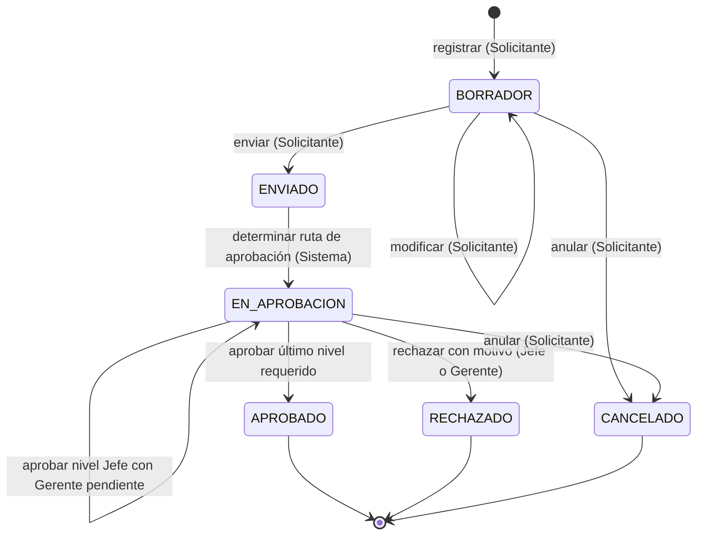

# Feature Specification: Registro y aprobación de pedidos

**Feature Branch**: `001-registro-aprobacion-pedidos`

**Created**: 2026-11-16

**Status**: Draft

**Input**: User description: "Especifica la feature usando como entrada @docs/prompts/features/001-registro-aprobacion-pedidos/01-specify.md"

## User Scenarios & Testing *(mandatory)*

### User Story 1 - Registrar y enviar un pedido (Priority: P1)

Un Solicitante registra un pedido de compra con una o más líneas (descripción, cantidad, precio
unitario en soles). El pedido queda en borrador; mientras siga así, el Solicitante puede
modificarlo. Cuando está listo, lo envía a aprobación y deja de poder modificarlo.

**Rol(es)**: Solicitante

**Why this priority**: Sin pedidos registrados no existe nada que aprobar; es la puerta de
entrada de todo el proceso.

**Independent Test**: Un Solicitante registra un pedido de dos líneas, modifica una línea,
lo envía y comprueba que el pedido está en aprobación, con su monto total y sin poder editarse.

**Acceptance Scenarios**:

1. **Dado** un Solicitante autenticado, **Cuando** registra un pedido con dos líneas válidas,
   **Entonces** el pedido queda en estado BORRADOR, con el Solicitante como creador y un monto
   total igual a la suma de cantidad × precio unitario de sus líneas, en soles.
2. **Dado** un pedido en BORRADOR del Solicitante, **Cuando** agrega, modifica o elimina una
   línea, **Entonces** el cambio se guarda y el monto total se recalcula.
3. **Dado** un pedido en BORRADOR con al menos una línea, **Cuando** el Solicitante lo envía,
   **Entonces** el pedido pasa a EN_APROBACION con su ruta de aprobación determinada por el
   monto total y queda pendiente del primer nivel, asignado al jefe directo del Solicitante.
4. **Dado** un pedido ya enviado, **Cuando** el Solicitante intenta modificarlo,
   **Entonces** el sistema lo impide e indica que solo se modifican pedidos en borrador.
5. **Dado** un pedido en BORRADOR sin líneas, **Cuando** el Solicitante intenta enviarlo,
   **Entonces** el sistema lo impide e indica que el pedido requiere al menos una línea.
6. **Dado** una línea con cantidad o precio unitario igual a cero o negativo, **Cuando** el
   Solicitante intenta guardarla, **Entonces** el sistema la rechaza indicando el dato inválido.
7. **Dado** un Solicitante sin jefe directo en el organigrama, **Cuando** intenta enviar su
   pedido, **Entonces** el sistema lo impide, informa la causa y el pedido sigue en BORRADOR.

---

### User Story 2 - Aprobar o rechazar como Jefe (Priority: P2)

Un Jefe revisa en su bandeja los pedidos pendientes que le corresponden y aprueba o rechaza
cada uno. Si el monto no requiere Gerente, su aprobación es definitiva; si lo requiere, el
pedido pasa al Gerente. Un rechazo exige motivo y es definitivo.

**Rol(es)**: Jefe

**Why this priority**: Completa el flujo mínimo de valor (registrar → aprobar) para la mayoría
de pedidos, que solo necesitan un nivel.

**Independent Test**: Con un pedido enviado cuyo monto solo requiere Jefe, el Jefe lo ve en su
bandeja, lo aprueba y el pedido queda APROBADO; con otro pedido, lo rechaza con motivo y queda
RECHAZADO.

**Acceptance Scenarios**:

1. **Dado** un pedido EN_APROBACION de S/ 1 200.00 pendiente de Jefe, **Cuando** el jefe
   directo del Solicitante lo aprueba, **Entonces** el pedido pasa a APROBADO.
2. **Dado** un pedido EN_APROBACION de S/ 8 000.00 pendiente de Jefe,
   **Cuando** el Jefe lo aprueba, **Entonces** el pedido sigue EN_APROBACION, pendiente de
   Gerente, y desaparece de la bandeja del Jefe.
3. **Dado** un pedido pendiente de Jefe, **Cuando** el Jefe lo rechaza indicando un motivo,
   **Entonces** el pedido pasa a RECHAZADO y el motivo queda registrado.
4. **Dado** un pedido pendiente de Jefe, **Cuando** el Jefe intenta rechazarlo sin motivo,
   **Entonces** el sistema lo impide.
5. **Dado** un pedido creado por un usuario que también es Jefe, **Cuando** ese mismo usuario
   intenta aprobarlo, **Entonces** el sistema lo impide (nadie aprueba su propio pedido) y el
   pedido no aparece en su bandeja; el pedido corresponde a su propio jefe directo.
6. **Dado** un pedido pendiente de Jefe, **Cuando** un Jefe que no es el jefe directo del
   Solicitante intenta aprobarlo o rechazarlo, **Entonces** el sistema lo impide y el pedido no
   aparece en su bandeja.
7. **Dado** que el Jefe decide sobre un pedido mientras el Solicitante lo anula, **Cuando**
   ambas acciones llegan a la vez, **Entonces** solo una se registra y la otra es informada de
   que el pedido ya cambió.

---

### User Story 3 - Aprobación de segundo nivel por Gerente (Priority: P3)

Para pedidos de monto alto, tras la aprobación del Jefe, un Gerente revisa en su bandeja y
aprueba o rechaza el pedido. El Gerente nunca actúa antes que el Jefe.

**Rol(es)**: Gerente

**Why this priority**: Controla los pedidos de mayor riesgo económico; se apoya en las
historias 1 y 2.

**Independent Test**: Un pedido de monto alto aprobado por el Jefe aparece en la bandeja del
Gerente; al aprobarlo queda APROBADO; un pedido de monto alto aún pendiente de Jefe no aparece
en la bandeja del Gerente.

**Acceptance Scenarios**:

1. **Dado** un pedido de monto alto aprobado por el Jefe, **Cuando** el Gerente lo aprueba,
   **Entonces** el pedido pasa a APROBADO.
2. **Dado** un pedido de monto alto aprobado por el Jefe, **Cuando** el Gerente lo rechaza con
   motivo, **Entonces** el pedido pasa a RECHAZADO y el motivo queda registrado.
3. **Dado** un pedido de monto alto aún pendiente de Jefe, **Cuando** el Gerente intenta
   aprobarlo, **Entonces** el sistema lo impide porque falta la aprobación previa del Jefe.
4. **Dado** un pedido creado por un usuario que es Gerente, **Cuando** ese usuario intenta
   aprobarlo en el segundo nivel, **Entonces** el sistema lo impide.
5. **Dado** un pedido cuyo monto total es exactamente S/ 5 000.00, **Cuando** el Jefe lo
   aprueba, **Entonces** el pedido sigue EN_APROBACION, pendiente de Gerente (RN-05).
6. **Dado** un pedido cuyo monto total es S/ 4 999.99, **Cuando** el Jefe lo aprueba,
   **Entonces** el pedido pasa a APROBADO sin intervención del Gerente.
7. **Dado** un pedido de monto alto aprobado por el Jefe, **Cuando** un Gerente que no está en
   la línea jerárquica del Solicitante intenta aprobarlo, **Entonces** el sistema lo impide y
   el pedido no aparece en su bandeja.

---

### User Story 4 - Anular un pedido (Priority: P4)

El Solicitante anula un pedido propio que ya no necesita, mientras no tenga una decisión final.

**Rol(es)**: Solicitante

**Why this priority**: Evita que pedidos innecesarios consuman tiempo de los aprobadores, pero
no bloquea el flujo principal.

**Independent Test**: El Solicitante anula un pedido en borrador y otro en aprobación; ambos
quedan CANCELADO y el segundo desaparece de la bandeja del aprobador.

**Acceptance Scenarios**:

1. **Dado** un pedido propio en BORRADOR o EN_APROBACION, **Cuando** el Solicitante lo anula
   indicando un motivo, **Entonces** el pedido pasa a CANCELADO y sale de toda bandeja.
2. **Dado** un pedido APROBADO, RECHAZADO o CANCELADO, **Cuando** el Solicitante intenta
   anularlo, **Entonces** el sistema lo impide.
3. **Dado** un pedido de otro Solicitante, **Cuando** un Solicitante intenta anularlo,
   **Entonces** el sistema lo impide.

---

### User Story 5 - Consultar mis pedidos (Priority: P5)

El Solicitante consulta la lista de sus pedidos con su estado y monto, y el detalle de cada uno.

**Rol(es)**: Solicitante

**Why this priority**: Da visibilidad del avance, pero el flujo funciona sin ella.

**Independent Test**: Un Solicitante con pedidos en distintos estados ve solo los suyos,
puede filtrarlos por estado y abrir el detalle de cualquiera.

**Acceptance Scenarios**:

1. **Dado** un Solicitante con pedidos en distintos estados, **Cuando** consulta sus pedidos,
   **Entonces** ve únicamente los suyos, con estado, monto total y fecha de registro.
2. **Dado** un Solicitante, **Cuando** filtra sus pedidos por estado, **Entonces** ve solo los
   pedidos en ese estado.
3. **Dado** un Solicitante sin pedidos, **Cuando** consulta, **Entonces** ve una lista vacía.

---

### User Story 6 - Historial de auditoría (Priority: P6)

Un Auditor consulta cualquier pedido y su historial completo: quién lo registró, envió, aprobó,
rechazó o anuló, cuándo, desde qué estado, hacia qué estado y con qué motivo.

**Rol(es)**: Auditor

**Why this priority**: Requisito de control y cumplimiento; el registro se genera desde la
historia 1, la consulta puede llegar después.

**Independent Test**: Tras recorrer un pedido por registro, envío, aprobación de Jefe y rechazo
de Gerente, el Auditor ve los cuatro eventos en orden cronológico con todos sus datos.

**Acceptance Scenarios**:

1. **Dado** un pedido con varias acciones, **Cuando** el Auditor consulta su historial,
   **Entonces** ve cada acción en orden cronológico con actor, fecha y hora, estado origen,
   estado destino y motivo (si lo hubo).
2. **Dado** un Auditor, **Cuando** intenta registrar, modificar, aprobar o anular un pedido,
   **Entonces** el sistema lo impide (el rol solo consulta).
3. **Dado** un usuario que no es Auditor, **Cuando** intenta ver el historial de un pedido
   ajeno, **Entonces** el sistema lo impide.

---

### Diagrama de estados del pedido

### Edge Cases

- **Transición no permitida**: modificar, enviar o anular un pedido en un estado que no lo
  admite se rechaza sin cambiar el pedido (RN-02, RN-08).
- **Autoaprobación**: el creador de un pedido nunca puede aprobarlo ni rechazarlo, en ningún
  nivel, aunque tenga el rol de Jefe o Gerente (RN-06).
- **Concurrencia**: dos decisiones simultáneas sobre el mismo pedido y nivel producen una sola
  decisión registrada (RN-10).
- **Reintento de registro**: si el Solicitante repite por error el mismo registro (p. ej. doble
  clic o reintento por fallo de conexión), se crea un único pedido.
- **Rol insuficiente**: cualquier acción realizada por un usuario sin el rol requerido se
  rechaza y no deja cambios.
- **Monto en el umbral**: un pedido de exactamente S/ 5 000.00 requiere Gerente; uno de
  S/ 4 999.99 no (RN-05).
- **Anulación durante la aprobación**: si el Solicitante anula mientras un aprobador decide, solo
  una de las dos acciones prospera (RN-10).
- **Sin aprobador en el organigrama**: si el Solicitante no tiene jefe directo, o no hay un
  Gerente por encima del Jefe en su línea jerárquica cuando el pedido lo requiere, el sistema
  impide el envío e informa la causa; el pedido sigue en BORRADOR (RN-11).
- **Cambio de organigrama**: si el jefe directo del Solicitante cambia después del envío, el
  pedido sigue asignado a los aprobadores determinados al enviarlo (RN-07).

## Requirements *(mandatory)*

### Functional Requirements

**Registro y edición**

- **FR-001**: El sistema DEBE permitir a un Solicitante registrar un pedido con una o más líneas,
  cada una con descripción, cantidad y precio unitario en soles (PEN).
- **FR-002**: El sistema DEBE calcular el monto total del pedido como la suma de cantidad ×
  precio unitario de sus líneas, expresado en soles con dos decimales.
- **FR-003**: El sistema DEBE crear todo pedido nuevo en estado BORRADOR, registrando al
  Solicitante como creador.
- **FR-004**: El sistema DEBE permitir al creador agregar, modificar y eliminar líneas solo
  mientras el pedido está en BORRADOR.
- **FR-005**: El sistema DEBE evitar que un mismo registro repetido por error genere más de un
  pedido.

**Envío y ruta de aprobación**

- **FR-006**: El sistema DEBE permitir al creador enviar un pedido en BORRADOR que tenga al
  menos una línea.
- **FR-007**: Al enviar, el sistema DEBE determinar la ruta de aprobación según el monto total
  (RN-05) y dejar el pedido EN_APROBACION, pendiente del nivel Jefe.
- **FR-008**: El sistema DEBE exigir que el nivel Gerente, cuando aplique, actúe solo después de
  la aprobación del Jefe.

**Decisión**

- **FR-009**: El sistema DEBE permitir al aprobador del nivel pendiente aprobar o rechazar el
  pedido.
- **FR-010**: El sistema DEBE exigir un motivo para rechazar y para anular.
- **FR-011**: El sistema DEBE marcar el pedido como APROBADO cuando el último nivel requerido lo
  aprueba, y como RECHAZADO cuando cualquier nivel lo rechaza.
- **FR-012**: El sistema DEBE impedir que el creador de un pedido lo apruebe o rechace.
- **FR-013**: El sistema DEBE permitir al creador anular su pedido en BORRADOR o EN_APROBACION.

**Consultas**

- **FR-014**: El sistema DEBE permitir a cada Solicitante consultar solo sus propios pedidos,
  con filtro por estado, en listas paginadas y ordenadas por fecha de registro (más recientes
  primero).
- **FR-015**: El sistema DEBE ofrecer a cada aprobador una bandeja con los pedidos pendientes
  que le fueron asignados (RN-07), excluyendo los creados por él mismo.
- **FR-019**: El sistema DEBE impedir que un Jefe o Gerente decida sobre un pedido que no le fue
  asignado.
- **FR-016**: El sistema DEBE permitir al Auditor consultar cualquier pedido y su historial
  completo, sin poder modificarlo.

**Trazabilidad**

- **FR-017**: El sistema DEBE registrar cada acción (registro, envío, aprobación, rechazo,
  anulación y cambio automático de estado) con actor, fecha y hora (UTC), estado origen, estado
  destino y motivo cuando exista.
- **FR-018**: El sistema NO DEBE permitir modificar ni eliminar registros del historial.

### Reglas de negocio

- **RN-01**: Un pedido tiene al menos una línea para poder enviarse; cantidad y precio unitario
  de cada línea son mayores que cero.
- **RN-02**: Solo un pedido en BORRADOR puede modificarse, y solo por su creador.
- **RN-03**: Todos los montos están en soles (PEN); no se admiten otras monedas en esta feature.
- **RN-04**: El monto total que define la ruta de aprobación es el del momento del envío.
- **RN-05**: Un pedido requiere aprobación de Jefe; requiere además aprobación de Gerente si su
  monto total es mayor o igual a S/ 5 000.00 ("monto alto"). El umbral es fijo y solo cambia
  con una nueva versión de esta especificación.
- **RN-06**: Nadie puede aprobar ni rechazar un pedido creado por él mismo (segregación de
  funciones).
- **RN-07**: El aprobador de nivel Jefe es el jefe directo del Solicitante según el
  organigrama. El aprobador de nivel Gerente es el primer Gerente en la línea jerárquica
  ascendente por encima del aprobador de nivel Jefe; así ambos niveles los deciden personas
  distintas. Los aprobadores se determinan al momento del envío (igual que el monto, RN-04).
- **RN-08**: APROBADO, RECHAZADO y CANCELADO son estados finales: no admiten más acciones.
- **RN-09**: Rechazar y anular requieren motivo; aprobar admite un comentario opcional.
- **RN-10**: Sobre un mismo pedido solo prospera una acción a la vez; una acción basada en un
  estado ya cambiado se rechaza.
- **RN-11**: Un pedido solo puede enviarse si el organigrama permite determinar todos los
  aprobadores de su ruta (RN-05, RN-07).

### Transiciones de estado

| Desde | Hacia | Acción | Rol autorizado | ¿Motivo obligatorio? |
|-------|-------|--------|----------------|----------------------|
| — | BORRADOR | Registrar | Solicitante | No |
| BORRADOR | BORRADOR | Modificar | Solicitante (creador) | No |
| BORRADOR | ENVIADO | Enviar | Solicitante (creador) | No |
| ENVIADO | EN_APROBACION | Determinar ruta de aprobación | Sistema (automático) | No |
| EN_APROBACION | EN_APROBACION | Aprobar nivel Jefe (requiere Gerente) | Jefe (no creador) | No |
| EN_APROBACION | APROBADO | Aprobar último nivel requerido | Jefe o Gerente (no creador) | No |
| EN_APROBACION | RECHAZADO | Rechazar | Aprobador del nivel pendiente (no creador) | Sí |
| BORRADOR | CANCELADO | Anular | Solicitante (creador) | Sí |
| EN_APROBACION | CANCELADO | Anular | Solicitante (creador) | Sí |

### Reglas de negocio y errores

| Regla | Código de error de negocio | Cuándo se produce |
|-------|----------------------------|-------------------|
| RN-01 | PEDIDO_SIN_LINEAS | Se intenta enviar un pedido sin líneas |
| RN-01 | LINEA_DATOS_INVALIDOS | Cantidad o precio unitario ≤ 0, o descripción vacía |
| RN-02 | PEDIDO_NO_EDITABLE | Se intenta modificar un pedido que no está en BORRADOR |
| RN-02, FR-013 | PEDIDO_NO_PERTENECE_AL_USUARIO | Un usuario modifica, envía o anula un pedido ajeno |
| RN-06 | APROBACION_AUTOAPROBACION_PROHIBIDA | El creador intenta aprobar o rechazar su pedido |
| FR-008 | APROBACION_NIVEL_NO_HABILITADO | El Gerente actúa antes de la aprobación del Jefe |
| RN-08 | PEDIDO_TRANSICION_INVALIDA | Se intenta una acción no permitida desde el estado actual |
| RN-09 | MOTIVO_REQUERIDO | Rechazo o anulación sin motivo |
| RN-07 | APROBADOR_NO_ASIGNADO | Un Jefe o Gerente actúa sobre un pedido que no le fue asignado |
| RN-11 | RUTA_APROBACION_INCOMPLETA | Se intenta enviar un pedido sin jefe directo o sin Gerente disponible en la línea jerárquica |
| RN-10 | PEDIDO_MODIFICADO_CONCURRENTEMENTE | La acción se basó en un estado del pedido que ya cambió |

### Key Entities *(include if feature involves data)*

- **Pedido**: solicitud de compra de un Solicitante. Atributos: identificador, creador, estado,
  líneas, monto total (soles), nivel de aprobación pendiente, fechas de registro y de última
  acción (UTC).
- **Línea de pedido**: elemento del pedido. Atributos: descripción, cantidad, precio unitario
  (soles) y subtotal.
- **Flujo de aprobación**: ruta de niveles que aplica a un pedido según su monto (Jefe, o Jefe y
  luego Gerente).
- **Aprobación**: decisión sobre un nivel del pedido. Atributos: nivel, aprobador asignado
  al enviar, decisión (aprobado/rechazado), motivo o comentario, fecha y hora (UTC).
- **Registro de auditoría**: constancia inmutable de cada acción sobre un pedido: actor,
  fecha y hora (UTC), estado origen, estado destino, acción y motivo.
- **Usuario**: persona que actúa en el sistema con uno o más roles (Solicitante, Jefe, Gerente,
  Auditor, Administrador) y que tiene un jefe directo en el organigrama (salvo la cima).
- **Organigrama**: relación jefe directo → colaborador que define la línea jerárquica usada
  para asignar aprobadores (RN-07).

## Success Criteria *(mandatory)*

### Measurable Outcomes

- **SC-001**: Un Solicitante registra y envía un pedido de hasta 5 líneas en menos de 3 minutos.
- **SC-002**: Un aprobador encuentra y decide sobre un pedido de su bandeja en menos de
  1 minuto.
- **SC-003**: El 100 % de las acciones sobre pedidos queda registrado en el historial con actor,
  fecha, estado origen, estado destino y motivo cuando corresponde.
- **SC-004**: El 0 % de los pedidos queda aprobado por su propio creador.
- **SC-005**: El 0 % de los pedidos de monto alto llega a APROBADO sin las dos aprobaciones
  (Jefe y luego Gerente).
- **SC-006**: El 0 % de los pedidos registra dos decisiones contradictorias o duplicadas en el
  mismo nivel.
- **SC-007**: Un Auditor reconstruye la historia completa de cualquier pedido en una única
  consulta, sin recurrir a otras fuentes.
- **SC-008**: El 95 % de las consultas de "mis pedidos" y de bandeja muestran resultados en
  menos de 2 segundos para el volumen operativo esperado.

## Assumptions

- **Correspondencia con la constitución**: "anular" equivale al estado CANCELADO. ENVIADO es
  un estado de paso: al enviar, el sistema fija de inmediato la ruta de aprobación y deja el
  pedido EN_APROBACION; ambos pasos quedan en el historial.
- **Roles**: Jefe y Gerente son aprobadores de nivel 1 y nivel 2. El Auditor solo consulta.
  Un usuario puede tener varios roles (p. ej. un Jefe también registra pedidos como Solicitante).
- **Moneda y redondeo**: todo en soles (PEN), con montos a dos decimales; cantidades enteras
  mayores que cero.
- **Pedidos rechazados**: RECHAZADO es final; para reintentar, el Solicitante registra un
  pedido nuevo.
- **Anulación**: se permite en BORRADOR y EN_APROBACION, nunca tras una decisión final.
- **Identidad y organigrama**: los usuarios, sus roles y su jefe directo provienen del
  mecanismo de identidad corporativo existente; esta feature los consulta, pero no los
  administra ni gestiona altas de usuarios.
- **Dos niveles, dos personas**: si el jefe directo del Solicitante es Gerente, aprueba el
  nivel Jefe y el nivel Gerente lo decide el siguiente Gerente de la línea jerárquica.
- **Volumen**: uso interno de la empresa; volumen operativo moderado (cientos de pedidos al mes).

## Fuera de alcance

- Notificaciones por correo u otros canales.
- Delegación o reasignación de aprobaciones (incluida la reasignación tras cambios de
  organigrama).
- Mantenimiento del organigrama.
- Expiración o escalamiento automático de pedidos pendientes.
- Adjuntos en los pedidos.
- Integración con ERP u otros sistemas externos.
- Monedas distintas al sol, catálogo de productos y presupuestos por área.
- Configuración de flujos de aprobación por el usuario (niveles y umbrales distintos a RN-05).
